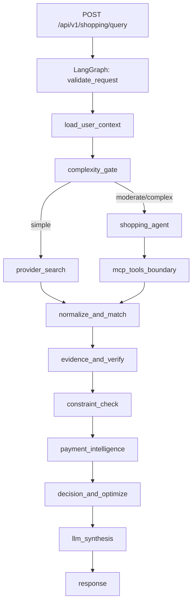

# Decision Advisor Backend (Phase 1)

This backend is a Python service designed to keep the existing frontend intact while providing real server-side orchestration for shopping requests.

## Core architecture



## Why this shape

- LangGraph handles state orchestration, routing, and deterministic + agentic blending.
- LangChain agent logic is used only for moderate or complex requests.
- MCP tool boundaries are explicit and capability-scoped.
- Deterministic services own ranking, payment math, and verification.

## Run locally

1. Create environment and install deps.
2. Start the API:

```bash
uvicorn app.main:app --reload --port 8001
```

## Endpoints

- `GET /health`
- `GET /meta/stack`
- `POST /api/v1/shopping/query`

## Where each library is used

- LangGraph: workflow orchestration in `app/graph/workflow.py`
- LangChain: model-backed planning in `app/agents/shopping_agent.py`
- MCP SDK / FastMCP: tool boundary in `app/mcp/server.py`

## Contract notes

- Query complexity controls whether the deep agent path is invoked.
- If model credentials are unavailable, the service keeps deterministic behavior and returns explicit warnings.
